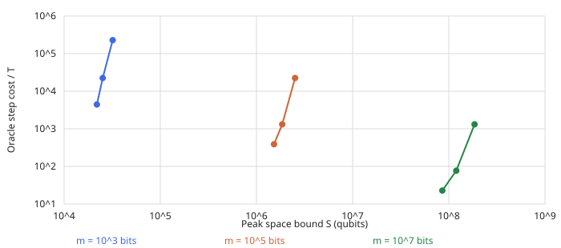

# Pebble: proofs, counterexamples, and the mixed chain game

Theory-track report, 10 November 2026. This document audits `docs/CORE.md`
against Bennett ISA 0.9. It does not modify CORE. Sections A and B contain
proved statements unless explicitly marked otherwise. Section C distinguishes
mathematical channel identities from engineering analysis. Numerical evidence
is never used as a substitute for a proof.

## Corrections to CORE

1. **Physical space is not `space(κ)`.** Nonzero symbolic scratch counts
   information-bearing wires, not allocated/live wires or evaluator scratch.
   A clean target of an evaluator is physically present. Every space bound
   below is a bound in the stated atomic game; an implementation must add its
   evaluator's transient workspace, interface storage, images not eliminated
   by staging, and any required controls.
2. **Lemma 2.4 has an overstrong consequence.** Constant controls can be
   specialised, and constant wires used only through gates can be eliminated
   by gatewise substitution. A quantum-addressed read from a classical image
   still requires a circuit implementing that image's lookup function.
   Constants are not an assertion that an arbitrary ROM, or kernel execution,
   has zero gate cost. Wire-dependent addresses can also make initially
   classical memory acquire nonconstant content.
3. **Theorem 2.5 needs a precise borrowed-wire quantifier.** Returning a dirty
   wire's basis value is insufficient if the computed answer depends on it.
   The answer must equal `F_B(x)` for every borrowed basis assignment, and the
   joint return map must be identity on the borrowed system. This implies
   correctness with arbitrary external entanglement. In fact the conjugated
   commit is an involution on the *entire* circuit Hilbert space, not merely
   the clean-input domain. The contract itself holds only on that domain.
4. **The rule calculus is sound under additional explicit conditions.**
   Operands and controls must have the stated disjointness; stable operands
   are preserved. InPlace requires a specified permutation extension with
   enough output and clean padding bits. A guarded inverse must use the
   same unchanged predicate. Relabel is zero gates only as a change of wire
   interpretation; a required physical permutation at a fixed ABI costs
   gates. Correctness of a circuit does not imply derivability in a fixed
   rule library. The advertised `iff` and linear-time checking of arbitrary
   compressed schedules do not follow from Theorem 2.5.
5. **Residues are conditional, width-sensitive certificates.** Shift counts
   must be restricted or saturated; for the ISA, *all* shifts by at least the
   width return zero, including `ashr` (§4.1), so then the full old word is a
   residue. For smaller arithmetic shifts, the low shifted-out bits suffice.
   A predicate depending on a dying word generally must be retained for a
   select. “Zero under its guard” permits dropping a *masked* residue, not
   an unmasked wire which happens to vanish on the active branch.
6. **Lemma 4.2 is valid for a prefix-stable family.** Fix all non-step limits,
   classical arguments, layout, nested token tuples and bindings, and vary
   only the enclosing B. No monotonicity of fault *codes* under increasing
   heap/stack/depth budgets is asserted by the ISA. The prefix-stable family
   includes well-formed ISA oracles with those parameters fixed. Inlining a
   nested oracle must preserve its separate step budget and atomic outer
   charge; expanding its internal rows into outer charges is incorrect.
7. **Lemma 5.2 requires simulation certificates, not syntactic labels.**
   Known callee bindings alone do not make call depth and stack faults
   classical. Dead-state removal uses an observational relation, not recovery
   of all discarded reference state. If-conversion must suppress faults and
   effects of unexecuted or later rows after the first fault.
8. **The horizon clause in Theorem 5.3 is false as printed.** A nonhalting
   run after B blocks of weight one has `c=B`, not `c>B`. Replace its
   sufficient horizon condition by `not halted after H => c_H >= B`.
   This makes `H=B` valid. Accumulation must be exact, or saturate at B+1;
   modular overflow is unsound.
9. **Construction 5.5 cannot erase arbitrary raw exit conditions from
   `(new pc, predecessor rank)`.** Inactive blocks' predicates and redundant
   predicates are not recorded there. Compute *active*, mutually exclusive,
   exhaustive exit flags; retain their truth vector through the data path,
   and erase those flags and dispatch by decoding the selected edge.
   Predicate-evaluation helpers must already be clean. All dynamic targets
   and HALT edges must be included in the predecessor sets.
10. **The chain game needs operational conventions.** Undup requires two
    distinct physical tokens at the same position and deletes only one;
    residues are shared *named values*, not token-owned. Every move must
    respect peak space including its endpoint configurations. The initial
    state must be prepared from the environment and ultimately reversed.
    Step cost and space must include or explicitly exclude evaluator
    workspace. The game does not describe every correct circuit.
11. **The limiting descriptions are not literal identities.** `r=0` makes
    direct history free in this game, with compute time `aT`, not `2T`;
    the complete oracle has time `2aT+commit`. An expression
    `S=p m+ℓ r` does not reserve p token slots and ℓ residue slots: the
    budget is fungible. In particular `ℓ=1` is not, by itself, the classical
    checkpoint-only pebble game. A precise checkpoint simulation is given
    in B.9.
12. **Item 18 and §6 are separate obligations.** Circuit soundness supplies
    the full-domain interface argument required for a pebbled expansion;
    it does not make every local erasure a syntactic `reverse` cleanup
    inside §6's unchanged-version window. Item 18 must be used for the
    realised expansion; explicit §6 cleanups require their own valid
    versions and computing sequences.

The exact unrestricted finite-game Bellman recurrence below is proved, but
is exponential and not a compiler algorithm. The useful interval recurrence
is proved optimal **only for the precisely defined nested class**. The
assertion that this class is unrestricted-optimal is left open, despite the
small-instance agreements. No billion-step optimality claim is made.

## A. Soundness and ISA fidelity

### A.1 Domains, tensors, and the move algebra (Lemma 2.3)

Let `W` be a finite set of labelled wires. For a set `A` write `H_A` for the
Hilbert space with computational basis indexed by `{0,1}^A`. Let `X` be the
full set of input and read-only-region basis assignments, with all classical
parameters fixed. The input encoding includes those assignments injectively.
The clean interface domain is the span of

```
|x>_I |t>_T |f>_F |0>_A .                         (A1)
```

Known local images can instead appear as fixed computational-basis strings;
conjugate their preparation and restoration by fixed X gates. The target T
and fault register F are arbitrary, not initially zero. The word “domain”
below refers to this linear span, not just to product states in it.

For each symbolic state κ, `enc_κ(x)` is a *basis string*. A sound move U is
an actual permutation on all its physical wires, identity on T and F, such
that `U enc_κ(x)=enc_κ'(x)` for all x. This is a specification only on the
reachable encoded subset. The circuit must still be a permutation everywhere.

**Proposition A1 (Lemma 2.3).** Composition, inversion, frame and guarding are
sound with CORE's stated support/disjointness hypotheses.

**Proof.** For every x,
`VU enc_κ(x)=V enc_κ'(x)=enc_κ''(x)`, proving composition. Applying the inverse
permutation to `U enc_κ(x)=enc_κ'(x)` proves inversion. For frame write a
basis string as its restrictions `(z_A,z_{W\A})`. Since
`U=U_A tensor I_{W\A}`, the second restriction is unchanged and the first
has exactly the claimed new value; evaluating at every x proves frame.
For guarding, p is outside U's support, so the controlled circuit is
`|0><0|_p tensor I + |1><1|_p tensor U_A`. Substitution of the basis value
`π(x)` selects precisely one summand and gives the claimed piecewise state.
The control is preserved. These arguments do not presume independence of
symbolic functions on different wires. ∎

All these basis equalities extend to vectors entangled with a reference R:
expand any vector in the domain as `sum_x,t,f |x,t,f,0> |η_x,t,f>_R`, apply
linearity, and leave each (not necessarily normalised or orthogonal) reference
vector unchanged. Density operators follow by linearity on outer products.
There is no basis-dependent phase, because these are exact permutation gates.

### A.2 Staging, with its actual scope (Lemma 2.4)

A positive-control multi-X gate changes a distinct target by the AND of its
control bits. If a control equals zero on every encoded x at the instant of
the gate, the target XOR is zero, so replacing the gate by identity agrees on
that entire encoded subset. If a control equals one there, removing that
factor preserves the target XOR. Negative controls have the corresponding
complementary rule. The following suffix receives identical basis strings,
so replacing the gate preserves the entire move. This proves Lemma 2.4's
local statement, including its extension to entangled states by A.1.

For a wire known to have a fixed bit at every use, substitute that bit into
each incident control. If it is a target, either the operation keeps its
content fixed, in which case it is removable on the reachable subset, or
its new symbolic content must be analysed and the wire is no longer a fixed
constant. Induction over the specialised gate list justifies elimination of
wires that remain constant throughout. This is the precise partial-evaluation
result. It does not justify omission of a nonconstant target.

For example a classical table `b_0,...,b_{2^q-1}` queried at a q-wire address z
must implement `t ^= b_z`. Take q=1 and table `(0,1)`: a CX from z to t is
necessary, even though both stored bits are classical constants. Arbitrary
larger tables implement arbitrary Boolean functions of z. Their *storage* may
be virtualised as compiler data; their lookup functions still have gate cost
and sometimes significant description size. Writable cells reached by a
superposed address require the same distinction. This is relevant to both a
kernel image and SQLite pages.

### A.3 Conjugated commit (Theorem 2.5)

**Theorem A2.** Suppose U acts on I and A only, is a permutation, and

```
U |x,0> = |enc_κ(x)>,
κ(R_y)(x)=y(x),   κ(R_e)(x)=e(x),
```

where `(y,e)=F_B` and the source bundles are outside T,F. Let K XOR their bits
into the corresponding target/fault bits, with no other writes. Then
`V=U^-1 K U` has the contract of CORE Theorem 2.5 on (A1), also with an
arbitrary reference system. As an operator on *all* wires, `V^2=I`.
For a wire q outside U and K,

```
U^-1 ctrl_q(K) U = ctrl_q(V)                     (A2)
```

on the full Hilbert space.

**Proof.** U first produces `enc_κ(x)` while leaving t,f unchanged. K changes
only t,f to `t xor y(x), f xor e(x)`. Its source registers and every other
wire of U's support are unchanged. Thus U's inverse receives exactly its
forward output and returns `(x,0)`; this proves the basis contract for every
x,t,f. A.1 proves the reference-system assertion. All the CNOTs in K have
controls outside its target bundles, hence commute and square to identity.
Consequently `V^2=U^-1 K U U^-1 K U=I`. On the q=0 subspace the left side of
(A2) is `U^-1 U=I`; on q=1 it is `U^-1 K U=V`. Since U does not act on q,
these block identities prove (A2). Garbage in κ has never entered the
argument except as the unchanged input to U's inverse. ∎

This proves the controlled oracle by controlling *only the commit*, even
when q is coherent and entangled with I,T,F,R. It does not assert that the
uncontrolled compute has become free, or that arbitrary intermediate scratch
can be released before reversal.

**Borrowed extension.** Add a borrowed bundle D with arbitrary basis value d.
It is sufficient that for every x,d the forward computation is a permutation
with the required output bundles `y(x),e(x)`, independent of d, and that
reversal restores `(x,d,0)` after commit. The same three-stage proof on
`|x,d,t,f,0>` establishes `V_ideal tensor I_D` on its clean domain. Expanding
in d as well as x proves restoration of all borrowed correlations with R.
Untouched borrowed wires satisfy this immediately. Local borrowing lemmas
may also establish it, but must be uniform over *every* d.

Returning D's basis value at every local move is insufficient: take one dirty
bit d, a clean output y, and U=CX(d,y). U leaves d unchanged but the oracle
commit XORs d into its target, violating any contract independent of d. If
“identity on D” instead means the full operator factorisation `U_0 tensor I_D`,
there is no problem; distinguish these two meanings.

### A.4 Rule calculus (Theorem 3.2 and Corollary 3.3)

A placement implicitly assigns zero to all unlisted non-interface wires. Its
input bundles must also be listed (otherwise it would incorrectly assign zero
to the environment). Rules never overlap a target with an operand to be
preserved. Let the finite library of semantic equations and evaluator
specifications be trusted or independently certified.

For InPlace the precise hypothesis is an injective map on *all* permitted old
basis words at fixed stable a,

```
u -> (v(u,a),ρ(u,a)),
```

plus a specified bijection on a fixed total bundle carrying old u and clean
padding to that output and any specified zero padding. The old and new total
physical widths agree. One must not treat a length-changing injective
function as an already given permutation. A permutation extension always
exists as a finite-set fact if the output encoding fits: its prescribed
images are distinct, and the equally many remaining domain and codomain
points can be paired arbitrarily. For bit circuits an explicit synthesis or
library certificate is still needed; with clean ancillas any finite
permutation can be implemented by transpositions using multi-controlled
flips, with ancillas restored. A transposition between arbitrary words is
obtained by conjugating an adjacent-word multi-controlled flip along a
Gray-code path and back; this also gives an elementary existence construction.

**Theorem A3 (corrected Theorem 3.2).** With these hypotheses, the stated rules,
their inverses and any finite composition are sound.

**Proof.** Eval maps `(u,0)` to `(u,f(u))`, whose denotation is the new value;
its XOR-form evaluator is self-inverse for every z, so its inverse clears
exactly that value. Copy is the case `f(u)=u`, implemented by one CX per bit.
InPlace substitutes actual stable a and old u into its specified bijection,
giving exactly the named v and ρ, with other padding zero. Its inverse is
the actual inverse permutation. Relabel changes the association of names to
physical wires; substituting that association leaves the physical basis
string untouched and proves its symbolic equality. If a physical swap is
instead demanded, use its actual SWAP circuit. Guard is Proposition A1(d):
on the inactive sector an out-of-place result remains zero, and an in-place
result remains old u; on the active sector the preceding proofs apply.
This proves both the forward and inverse rule instances, provided the same
unchanged guard is used. Proposition A1(a) proves any derivation. ∎

For a DAG, give each node v a fixed out-of-place evaluator reading its
predecessor bundles and writing a clean v bundle. Adding its pebble is Eval;
removing it with those predecessors still present is the inverse Eval.
Induction on a legal DAG pebbling gives a derivation. Conversely a derivation
restricted to these evaluators, one bundle per node and this presence rule,
is a reversible DAG pebbling. This proves Corollary 3.3 with that convention.
Repeated values or Copy create a richer fragment, so “Eval-only” must include
the bundle convention. The InPlace cases are proved next.

Sound derivations imply a correct answer by A2. The converse, for an arbitrary
fixed library of rule schemas, has not been established. Nor are arbitrary
function equalities fast to decide. A replay checker is linear in the number
of **explicit rule instances** only if certified semantic lemmas are indexed
in constant amortised time and bookkeeping is bounded. For a compressed
`rep` or recursive DAG it needs proved invariant schemas, not B independent
replays. These are additional trusted/checkable objects.

### A.5 Residue audit, entry by entry (Definition 3.4)

All arithmetic on an n-bit word below is modulo `2^n`, with `n>=1`.
“Stable” means that the operand's physical version is present unchanged at
the inverse use. A residue's width is a sufficient width, not an assertion
that it is minimum on a restricted reachable domain.

1. **Add, subtract, XOR, constant add, NOT, rotate.** Given stable a,
   `u=v-a`, `u=v+a`, and `u=v xor a`, respectively, recover u. Constant add
   is the same. NOT is its own inverse. A rotation has the inverse rotation
   with count reduced modulo n. These explicit inverses prove injectivity
   with no residue. Stable a cannot secretly be the dying version of u.
2. **Odd multiplication.** If c is odd and `cu=cv mod 2^n`, then
   `2^n | c(u-v)`; coprimality gives `2^n | u-v`, so the n-bit words agree.
   Equivalently the inverse is multiplication by c's inverse modulo `2^n`.
   For comparison an even nonzero c with `gcd(c,2^n)=2^s` has fibres of
   size `2^s`; s suitably chosen old bits suffice, but the table only
   claims the odd case. c=0 needs all n old bits in the unrestricted domain.
3. **Logical right shift.** For `0<=c<n`, let `ρ=u mod 2^c` and
   `v=floor(u/2^c)`. Then `u=2^c v+ρ` in the ordinary integers.
   For c=0 the residue is empty. The n-bit output contains c leading zeros,
   and the output plus c-bit residue uses n+c positions: the c extra clean
   positions must be supplied or interpreted as virtual zeros. For c>=n,
   ISA §4.1 gives v=0; all n bits, not “c bits”, are a sufficient and
   necessary unrestricted residue.
4. **Left shift.** For `0<=c<n`, let `ρ=floor(u/2^(n-c))`. The output
   determines `u mod 2^(n-c)` by shifting back c positions, and
   `u=(v/2^c)+2^(n-c)ρ`. Hence the high c bits suffice. For c>=n output is
   zero and all n bits are required. Output low zeros need physical or
   virtual padding as in the preceding case.
5. **Arithmetic right shift (needed for ISA fidelity).** For `0<=c<n`,
   the output's low n-c bits are exactly u's old high n-c bits, and the
   high c output bits repeat u's sign. Concatenate those low n-c bits
   with u's low c bits to recover u. CNOT fanout of the sign supplies the
   output padding. For c>=n *this ISA returns zero*, rather than the
   sign-filled word familiar from some languages. The full n-bit residue
   is then necessary. This statement follows the explicit “shift >= N → 0”
   in §4.1 and its reference-library shift rule; do not use a host language's
   masked or sign-saturating shift without an explicit guard.
6. **Truncation.** If the retained width is k with `1<=k<n`, then
   `v=u mod 2^k`, `ρ=floor(u/2^k)` and `u=v+2^kρ`. The dropped n-k high
   bits suffice, and this is just reinterpreting the original wires.
7. **Zero/sign extension.** Both retain every original bit as the low n
   bits, proving injectivity. Zero extension appends known zeros. Sign
   extension appends copies of the high old bit, made and cleared by CX;
   thus it is not purely a wire relabel. Neither needs a residue.
8. **Select.** Let a include stable operands. For branch b in `{0,1}`,
   suppose `(e_b(u,a),ρ_b(u,a))` is injective in u. If `p=p(a)` is stable,
   the pair `(v, masked ρ_0, masked ρ_1)` recovers u using the selected
   branch's inverse; the unselected residue is zero. There is no need to
   retain an extra p. If `p=p(u,a)`, retain its old bit, then apply the
   same inverse with that bit. Comparing two equal output/residue tuples
   first gives equal p and then, by that branch's injectivity, equal u.
   Without p the claim fails even for individually invertible arms:
   on one bit take `p=u`, true arm `NOT u`, false arm u. Both inputs
   yield v=0. A stored predicate is needed unless it is otherwise
   recoverable. Controls for the branch circuits are separate wires from
   the dying u; they are captured before u changes and are not overwritten
   inside a controlled arm. The stored p is a residue, not scratch one
   can uncompute from the changed u without further argument.
9. **Composition.** If `(v,ρ_1)` recovers u and `(w,ρ_2)` recovers v,
   `(w,ρ_2,ρ_1)` recovers u in that order. This proves the union bound
   on widths, even though later joint compression may improve it.
10. **Fallback ρ=u.** Equality of output/residue tuples immediately gives
    equality of u. Compute v out of place and reinterpret the old u
    bundle as residue. This is exactly why displaced old values suffice
    in the reference expansion.

**Masked-zero rule, proved.** A guarded residue must have actual denotation
`h(x)ρ(x)` bitwise, with zero on the inactive branch. If `ρ(x)=0` whenever
`h(x)=1`, this denotation is identically zero on X, so it is clean and needs
no retained wire. If the residue is unmasked, the conclusion is false:
let h be a bit and `ρ=NOT h`; ρ vanishes when h=1 but is not globally clean.
One must keep the old inactive word in place or prove a conditional reversible
extension that supplies the omitted zero. For an even-tested right shift,
`h => lowbit(u)=0` gives exactly the masked-zero proof. It does not permit
erasing the old predicate if its version is still needed.

**Proposition A3a (information bound for a residue).** Fix the stable operand
and a finite allowed old-word domain. If the largest fibre of `u -> v` has
size M, any fixed-width binary residue needs at least `ceil(log2 M)` bits,
and that many bits suffice as an abstract function. Over several stable
operand values take the maximum M.

**Proof.** All M old words in one fibre have the same v, so their residue
strings must be distinct. An s-bit residue has only 2^s strings, hence
2^s>=M. Conversely order the old words in each fibre by their integer value
and assign each its within-fibre index padded to ceil(log2 M) bits. Equal
v and equal index then specify the same old word, proving injectivity.
This proves existence of a Boolean residue function, not cheap synthesis
of its ranking circuit. ∎

These reconstructions prove every corrected table entry. In particular,
Collatz's even branch may discard its shifted-out zero bit, while the odd
`3u+1` arm is a bijection modulo `2^64`; the old parity bit may still be
needed to distinguish the arms. Reachable-state restrictions can sometimes
recover parity from the output, but that requires a separate proof and is
not implied by invertibility of the two arms.

### A.6 Budget truncation (Lemma 4.2)

Fix an object, its reference body and numeric label semantics, classical
arguments, read-only-region bindings, valid nested tokens and their tuples,
and the enclosing heap/stack/depth limits. Define the **step-unbounded run**
by removing only the enclosing step cutoff. Keep every row's original
allocation, depth, stack, bounds, division and explicit-fault checks. Keep a
nested oracle row as one deterministic outer operation given by that callee's
own bounded `F_β`; do not remove that callee's cutoff. Permutation calls likewise
retain their actual finite semantics. Calls to lprocs contribute their own
rows and the call and return rows to the same outer count. Every row is total
on its allowed state, and a halting fault or retval is terminal. Let N count
the halting row, with N=infinity for a nonhalting run.

Call a parameterised family **prefix-stable in B** if, for each x, all of its
bounded runs agree with this single deterministic run until their cutoff.

**Theorem A4 (corrected Lemma 4.2).** For a prefix-stable family,

```
F_B(x) = (y,0)       if the unbounded run succeeds with y and N<=B;
         (0,C)       if it faults with effective cause C and N<=B;
         (0,BUDGET)  otherwise.                            (A3)
```

The ISA families fixed as above are prefix-stable.

**Proof.** Initially the states agree. If the first t rows agree and neither
has halted or reached the enclosing cutoff, the next row reads the same
state and fixed parameters. None of its operations reads the remaining outer
step counter: §14.1 uses it to stop after B rows; §5.4 fixes budgets before
entry. All row flags, successors and effects are therefore identical.
Induction proves agreement for every t up to B or the first halt. If a halt
occurs at row N<=B, §5.2 commits exactly its success result or first effective
fault cause, proving the first two cases. Otherwise the bounded interpreter
has executed B rows without halting and §5.2 returns budget exhaustion.
This includes B=0. The induction uses the same callee function in both runs
because nested token tuples are fixed, and counts its row as one by §3.7.
It uses the same prospective widened sums and limits for alloc and call.
Thus all the stated ISA families satisfy the hypothesis. ∎

The unbounded counters in §14.1 do not remove resource checks. The minimal
finite counter widths in §3.7 suffice on reachable states because every
increment is guarded against its limit and every prospective sum is widened.
A compiler may simulate the post-budget reference trajectory for longer,
but must preserve these facts and count its semantic row prefix; doing so
never changes (A3).

The success-monotonicity paragraph in §5.4 says only: a successful trajectory
under limits β remains successful with the same result under larger valid
limits, when other arguments and nested tokens are fixed. The proof is that
all limit flags false on that trajectory remain false and induction preserves
the path. It does not say faults have monotone causes. For example an alloc
followed by division by zero faults on the allocation under a small heap limit,
and faults on division under a larger one. Varying a nested token's B can
change its returned payload/fault register and the caller's later branch, so
it does not define the prefix-stable family just used. Similarly limits
influencing caller arguments are not fixed limits. These restrictions are
semantic, not a claim that all coherent paths have the same run length.

### A.7 A simulation definition that supports the compilation theorems

Use reference states q *without reversible history*, but with every logical
location, memory cell, allocator entry, call record, pc and terminal outcome
specified by §14.1. Let `q -> q'` be its deterministic one-row transition;
terminal states have no executed reference rows. Keep x and the fixed
parameters implicit. An abstract state `(b,s)` is related to q by a relation R.
It need not determine q: dead values may be forgotten.

A **segment simulation certificate** consists of initial and terminal clauses
and the following universal condition. For every *reachable* related pair
`(b,s) R q` with b nonterminal, `δ(b,s)=(b',s')` represents exactly
`w=ω(b,s)>=1` reference rows from q to q', with no terminal state before the
last row, and `(b',s') R q'`. If b'=HALT, q' is terminal and its outcome agrees
with s'. If q' is terminal then b'=HALT. Initial states are related and neither
is terminal before a row unless that exceptional entry behaviour is explicitly
specified. Terminal stuttering is abstract padding and has semantic weight
zero. The relation must respect the immutable environment and terminal output.
It must cover every x, not just successful test traces.

**Proposition A5 (corrected Lemma 5.2).** Segment merging, inlining,
if-conversion and dead-state elimination preserve this definition under the
following sufficient certificates.

**Proof.** For merging, compose the component reference traces in order.
The intermediate relation clauses supply the next related pair, their weights
add, and the no-early-halt condition follows by ending the merged segment at
its first terminal row. This proves the transition condition and the other
clauses are unchanged. If there are several exits, perform this proof for
each feasible guarded path; a path's own summed weight must be used.

For inlining an lproc instance, substitute its fixed token/classical/region
bindings and represent its call and return state transitions, including the
§3.7 capture, location saves and counter/check semantics. Entry relates the
same states, each callee segment satisfies its original transition clause,
and concatenation as above preserves the caller relation. The call row and
return row each contribute one. Counter faults may be replaced by classical
truth values only if a full-domain analysis proves those exact truth values
at each call. Static binding alone supplies no such proof: two coherent
paths may reach a call at different depths or with different sp. Concretely,
let one branch execute an extra completed call to f and another skip it,
then join before a common call to f. With stack_limit=R_f and depth_limit>=1,
the first call fits, but its monotonic reference stack leaves sp=R_f after
return. The common call therefore faults on that branch and succeeds on
the skipped-call branch, whose sp is still zero. Both calls have the same
fixed binding instance. A nested
oracle can be expanded internally, but its entire computation remains one
outer semantic row and must use its explicit token's own cutoff. These
conditions prove the transition clause for inlining; deleting a failing call
or changing its charge would not.

For if-conversion, enumerate the candidate rows in their reference order
along the selected path. Before row i form its path guard and an `active_i`
bit that is true precisely when that row is reached and no earlier row has
halted or faulted. Evaluate its flag on the correct incoming versions, and
perform its effects only under `active_i` and any row-internal flag guards.
The first triggered terminal flag writes the terminal outcome, and all later
active bits are zero. Induction on i gives equality of the logical state,
next row and first fault with the reference after each executed row. Inactive
predicate computations must be reversible and cleaned, and have no reference
fault or external effect. This proves the complete segment clause, with
weight equal to the number of actually executed reference rows. A speculative
host trap is not a reference-semantic implementation of an inactive divide.

For dead-state elimination let s be a projection of q to retained values and
let R mean that projection equality. Prove that equivalent q's have the same
segment length, terminal status and outcome, and equivalent successor q's.
Then defining δ and ω on equivalence classes is well-defined and directly
satisfies the transition clause. More general observational relations use
the same universal clause. Forgetting a location that can later affect a
branch, fault, indirect jump or address violates this premise. No proof needs
to reconstruct forgotten dead cells from s. ∎

A simple fault-order counterexample to unchecked if-conversion is a segment
`faultif p 5; faultif q 7`. On p=q=1 its result is 5. Independent fault flags
combined by XOR give 2, and a priority encoder in the reverse order gives 7.
Both violate §5.2 even if successful paths agree. A block must count and keep
the first fault under the *sequential* active guards. Removing a logical
location in the simulation does not authorise physically releasing a dirty
wire: the new abstract transition must still obtain an injective residue
realisation under A3/A7. Simulation and reversible data representation are
separate obligations.

### A.8 Bounded block execution (Theorem 5.3)

Let c count executed reference rows, frozen on HALT. At nonterminal abstract
steps it increases by ω>=1. Use integer arithmetic of sufficient width or
saturation `c := min(B+1,c+ω)`. Saturation is sound for the predicates `c<=B`
and `c>B`: by induction it equals the true count capped at B+1. If unbounded
ω itself exceeds the available width, compare before narrowing. To implement
an H'-step circuit, HALT acts as an identity data transition with zero semantic
weight; it may still have a declared unit atomic gate-game price.

**Theorem A6 (corrected Theorem 5.3).** Suppose the segment simulation holds
and, after H steps, every still-active run has `c_H>=B`. For any finite
`H'>=H`, the commit formula in CORE Theorem 5.3 computes F_B. One may take
H=B.

**Proof.** If the abstract run halts by H', concatenate its certified segments.
This is exactly the reference prefix through its first halt, with total
length c (or with the same comparison to B under saturation). When c<=B,
(A3) gives exactly its success or fault and the formula returns it. When
c>B, (A3) returns budget exhaustion, as does the formula. If the abstract run
is active after H', it was active after H and has already represented at least
B reference rows without a halt. Any later reference halt must therefore have
index at least B+1, so (A3) again gives budget exhaustion. The formula has
that case explicitly. Finally if a run is active after B block steps, all B
steps were nonterminal and their weights sum to at least B. This proves the
horizon condition for H=B, including the vacuous B=0 prefix. ∎

The printed condition `c_H>B` is stronger than necessary and its assertion
that H=B satisfies it is refuted by an infinite loop of unit-weight blocks.
The formula itself at H'=B still works.

If a sound analysis proves that for each time/block pair `(t,b)` the *incoming*
c has one fixed classical value, row counting can be specialised per pair.
For each possible outgoing edge, also preserve its own length and hence its
resulting count. Over-budget nonterminal continuations may be collapsed to
a designated budget outcome without executing later reference rows: they
can no longer yield N<=B. A transition which contains a terminal row at or
before B must first handle that outcome. This is an instance of (A3), not
permission to prune a whole partly over-budget superblock before checking
its earlier faults. The reachability analysis must be an overapproximation;
false negatives are unsound. When counts at a time/block pair disagree, c
or equivalent distinguishing state cannot be dropped by this argument.

### A.9 Predecessor ranks (Construction 5.5 and Lemma 5.6)

At time t enumerate all feasible outgoing *edges* `(b,e)` of reachable b,
including faults, successes, dynamic jump targets and HALT padding. Edges,
not merely predecessor blocks, matter: two exits of one block may have the
same successor. Assign an injective rank among incoming edges to each b'.
Let `d_t=max(1,max_b' |Pred_{t+1}(b')|)` and allocate `ceil(log2 d_t)` bits.
For every valid reachable `(b',rank)` a fixed decoder returns the unique
old b and e. Its arbitrary values on invalid combinations are irrelevant but
its XOR-form circuit is globally a permutation. Reach sets include HALT
once reached, with its self-loop. Empty predecessor sets are never decoded
on a valid forward execution.

The raw-predicate interpretation fails. If CORE intended all cond flags to
be active and one-hot already, the repair below makes that hypothesis explicit,
and its decoder erasure is sound. For a raw-predicate counterexample let active
block A and inactive block C both go to HALT, and let C's raw predicate be
an input bit x. The actual active edge and its rank are constant, independent
of x, so `(HALT,rank)` cannot erase C's raw x. Even in the active block,
a redundant predicate not distinguishing exits need not be recorded by rank.

Here is a corrected step.

1. Compute dispatch bits `at_b=[old pc=b]`, one-hot on the reachable domain.
2. On the *old* data versions compute flags
   `h_b,e = at_b AND [selected exit of b is e]`. They are exhaustive and
   mutually exclusive: exactly one is one. Uncompute all evaluation helpers
   while those versions are still present, leaving only these output flags.
   Complex blocks may use a certified internal reversible path; its retained
   edge result must equal this selected-exit function.
3. Apply the block's data map under its stable dispatch/edge controls, keeping
   its certified data residues. Its specified new state includes the correct
   counter and outcome. Compute fresh `pc'` and rank by XORing each edge's
   successor and rank under h. Both targets started clean, so one-hotness
   gives their correct values.
4. XOR `decode_old(pc',rank)` into the old pc. The decoded b is the actual
   old pc, so this bundle becomes zero. Interpret pc' as the new pc.
5. XOR `decode_edge(pc,rank)==(b,e)` into each h, and XOR
   `decode_old(pc,rank)==b` into each at_b. On the reachable domain each
   XOR clears its flag. Decoder helpers are uncomputed without changing
   pc or rank. The old pc is already clean; release all step helpers.

**Theorem A7 (corrected Lemma 5.6).** If the data maps and flag evaluators
have the certified specifications just stated, this step realises
`{σ_t} -> {σ_{t+1},ρ_t}` with all other step scratch clean.

**Proof.** Fix x. Reachability puts its actual old pc in Reach_t, so dispatch
is one-hot. Deterministic segment semantics makes exactly one h true. The
data rules therefore execute exactly that block's specified map, with its
residues, by A3 and guarding. The XOR targets pc',rank receive precisely the
selected edge's successor/rank. Rank injectivity makes their decoder equal
the original block and chosen exit. Step 4 cancels every bit of old pc.
Step 5 cancels every previously computed h and dispatch bit, including the
zero inactive ones. Helper evaluators and their inverses leave no other
scratch. This proves the named output state pointwise. Every operation is
an actual permutation on fixed wires, so it is a sound move by definition;
its inverse restores the complete input state and clears its frame by A1.
The reference-system extension follows from A.1. ∎

No assertion is made that arbitrary data-path helper predicates follow from
rank. They must be cleaned by their own certified local construction or be
included in the data residue. Nor must one allocate a literal one-hot array:
recomputing one decoder bit at a time has smaller workspace and the same
proof, with its extra gates charged. The maximum incoming-edge rank is not
a lower bound on all possible implementations; reachable data may reveal
some predecessor information and allow further compression.

### A.10 Exactly which ISA obligations have been proved

With A3-certified moves, A7-certified steps, A6's horizon and A2's commit,
the final interface map agrees for every basis assignment with the normative
§5.2 construction. Inputs and `in` regions are restored, private scratch is
zero or at its prepared image, and the borrowed extension restores arbitrary
borrowed correlations. A.1 makes this exact equality on span(D) with arbitrary
external reference, establishing the extensional part of §5.7/T6, not merely
agreement on classical probabilities. This is conditional on all the cited
certificates; this report does not certify a Linux or SQLite compiler.

It is **not** true that every erasure in these circuits is automatically a
§6 `reverse` of a still-current computing sequence. For example a bit y can
be computed from old u, u changed by a reversible update, and y erased from
the updated value by an algebraic identity. A3 may justify that erasure,
but it is not the adjoint of y's exact original producer on its original
input versions. Similarly a predecessor flag erased by a decoder is not
syntactically its original predicate evaluator. Section 6.2's same-version
and window obligations are stronger than equality of the resulting function.
One cannot label these erasures `reverse` without a valid reorganisation and
proof. `recompute` also has the specified same-sequence/window requirements.
Restoring a memory cell's numerical value does not undo its version advance
for §6.2.

Use §17 item 18's expansion-library hook for the complete pebbled oracle
realisation. It explicitly demands a full-domain clean-scratch and borrowed-
correlation argument, which the preceding construction supplies under its
hypotheses, and a list of *every* generated allocation, copy, forward and
inverse evaluation and release, with distinct execution ordinals and scratch
identities. Repeated work must be executed and charged; a schedule must bind
the library's name, version and hash; the frame descriptor must describe the
realised history. T2 remains the theorem about the reference expansion.
A hierarchical description can generate this list lazily with indexed
ordinals; it cannot omit repetitions from accounting. The text does not by
itself prove a particular compressed certificate format meets every sched/
cert field. A producer must additionally demonstrate its format's expansion
and conformance. Any explicit region-level §6 cleanup entries still require
their exact computing sequences, effective controls and version/window proofs.
Thus “permutation-circuit correct” and “valid §6 cleanup annotation” are
separate conclusions.

The fixture `collatz.bobj` is explicitly **ISA/object/ABI 0.8**, despite being
a useful arithmetic smoke test. Its location-argument `lift.call` spelling
with empty extra binding groups agrees with the 0.9 empty-group convention,
but it is not a 0.9 conformance certificate. The reference loop also executes
64-bit wrapping arithmetic and an 8-bit wrapping iteration counter. It is not
a proof of termination or of unbounded-integer Collatz. A finite B oracle is
total regardless of that open number-theoretic question. Its conditional
lproc call still requires the call/return rows and resource checks just proved.

## B. The mixed chain game

### B.1 Exact game and conventions

Fix integers `T>=0, m>=1, r>=0, S>=0`, a forward/inverse step price `a>0`
and copy/uncopy price `k>=0`. A state is `(τ,E)` with a **nonempty multiset**
of token positions `τ` in `{0,...,T}` and a set of residue names
`E subset {0,...,T-1}`. Distinct occurrences in τ mean disjoint m-wire
bundles with the *same* named value at the same position. There is at most
one live residue bundle of a given name. Its denotation depends on the
chain index and the environment, not on the token that produced it.

Space is `m |τ| + r |E|`; only states within S are allowed. An Adv moves
one occurrence j to j+1, requires j<T and j not in E, and adds j to E.
Ret reverses exactly this operation: move one j+1 to j and remove j from E.
Each costs a. Dup adds a second occurrence at an already occupied position,
at cost k; Undup requires at least two occurrences there and removes just
one, also at cost k. The latter cannot erase a lone token. Both endpoints
of every move must fit. There is no restriction that the residue be used by
the same physical token that made it. These are the fixes to Definition 6.1.
No value-dependent or measurement move is allowed.

Start is `({0},empty)`. If S<m the game is infeasible, even for T=0.
Otherwise the goal is first arrival at any state containing T; no cleanup
or surviving token at 0 is required. `D(T,S)=Time*(T;S)` is its shortest
cost, infinity if unreachable. B's formulas are for this *compute* cost;
the complete compute/commit/reverse oracle costs `2D+commit`. Initialisation
of σ_0 from x and final output extraction, if not free wire interpretations,
are separate costs. Interface input storage is also separate from S.

The game abstracts atomic moves whose evaluator scratch is not counted.
It is an implementable peak-qubit bound only after accounting for that
scratch, or after proving it fits a common additional reserve. This matters
when m is a large memory state and the step circuit itself uses address-
decoding space. Residues of width zero remain names in E, so the inverse
still has a record of *which* step is being reversed in the classical schedule.

### B.2 Soundness (Theorem 6.2)

Assume for each index j a certified permutation move

```
(σ_j,0_padding) <-> (σ_{j+1},ρ_j,0_padding)
```

has price a and the declared atomic space, uniformly over the environment,
with all other live values framed. Every copy has price k and is bitwise CX.
Copy means coherent computational-basis fanout, not cloning an arbitrary
unknown quantum state; all tokens can remain correlated with x and R.
The same ρ_j denotation must work for all replays at that index; if the
machine is time-dependent, its time is part of that named step.

**Theorem B1.** Every legal play is a sound derivation; a play reaching T,
followed by a correct extraction/commit and the exact reversed play,
implements the oracle whenever σ_T determines the required F_B.

**Proof.** Assign a disjoint bundle to each token occurrence and each live
residue name. At start the placement has just σ_0 (plus framed environment).
For Adv, absence of j in E supplies a clean residue location and the
specified step changes exactly the chosen token and this location. For Ret,
the token contains σ_{j+1} and the named residue contains ρ_j, so the inverse
specification restores σ_j and clears that residue; its physical producer
need not have been this token. Dup is Copy into a clean m-wire bundle.
For Undup two disjoint equal σ_j bundles exist; bitwise CX from one to the
other clears the second. Frame and composition prove the induction on all
moves. Space legality supplies the required physical value bundles in this
atomic model. A2 applied to the resulting compute and output bundles gives
the oracle, with all game garbage reversed. If preparing σ_0 required a
circuit, append its inverse at the end as well. ∎

### B.3 An exact unrestricted recurrence, with proof of optimality

There is a completely exact, but exponential, answer for every finite
instance. This is useful as a small-instance oracle and a specification,
not as the proposed optimiser.

Let `P=floor(S/m)` and let G be the finite graph of all legal configurations
on positions 0 through T, with the moves in B.1 as weighted edges. When
P>=1, its vertex count satisfies

```
|G| <= 2^T [ binom(T+P+1,P) - 1 ] =: M.             (B1)
```

Indeed the number of multisets of q positions among T+1 choices is
`binom(T+q,q)`. Summing q=0,...,P gives `binom(T+P+1,P)`; omit q=0,
then multiply by all residue subsets. The actual space constraint only
removes states. All edges are reversible with the same price in each
direction.

Define `d_0(v)=0` at the start and infinity elsewhere, and

```
d_{h+1}(v) = min(d_h(v), min_{u -> v}[d_h(u)+price(u,v)]).   (B2)
D(T,S)     = min_{v: T in τ_v} d_{M-1}(v).                  (B3)
```

**Theorem B2.** (B2)–(B3) give the exact unrestricted optimum.

**Proof.** Induction on h shows d_h(v) is the least cost of paths from the
start to v with at most h edges: a path either already has at most h edges,
or consists of such a path to u and its last edge. All prices are
nonnegative. Removing a repeated-vertex cycle from any path does not
increase its cost. Therefore any reachable vertex has an optimal simple
path with at most `|G|-1<=M-1` edges. The minimum over goals gives the
least cost of any legal play. Unreachable states retain infinity. ∎

Dijkstra implements the same answer without enumerating all edges initially;
it terminates even when k=0. Branching is O(P), including copy positions, so
explicit graph time is `O(M P log M)` and storage `O(MP)` or less with
implicit edges. This is not polylogarithmic in T. Giving this recurrence
does not resolve the much more interesting question of a small unrestricted
recurrence or a scalable exact optimiser.

### B.4 A finite bound on the unrestricted reachable length

Here is a self-contained combinatorial bound, also supplying an upper search
cutoff for the phrase “largest reachable T”. It is deliberately not tight.
Assume r>0 and S>=m. Let

```
K(S)=max{q+e: q>=1,e>=0 integers, qm+er<=S}.           (B4)
```

It can be evaluated by maximising `q+floor((S-qm)/r)` over
`1<=q<=floor(S/m)`. Define `U(S)=2^(K(S)-1)-1`.

**Lemma B3 (ordinary pebble bound).** In the ordinary reversible line game
with node 0 permanently occupied and at most n other pebbles, no pebble can
reach beyond `2^n-1`.

**Proof.** A configuration with k placed pebbles and f=n-k free pebbles is
called eliminable if its placed pebbles can be deleted in some order such
that at each deletion the distance to the nearest remaining predecessor
(including 0) is at most `2^(current free count)`. These deletions are for
this auxiliary definition, not asserted to be single game moves.

First prove by induction on k the following property: if a configuration
is eliminable, deleting *any* currently eligible pebble leaves it eliminable.
For k=0 or 1 this is immediate. For k>1 let a be the first deletion in a
successful order and let b be any other currently eligible pebble. If a=b
there is nothing to prove. Otherwise deleting a leaves an eliminable
configuration with k-1 pebbles. Pebble b remains eligible after that deletion:
if its nearest predecessor was a, the new gap is a sum of two gaps each at
most `2^f`, hence at most `2^(f+1)`; otherwise its gap is unchanged. The
same statement holds with a and b interchanged (removing the right-hand
pebble cannot harm the left-hand one's gap). By the induction hypothesis,
after deleting a one may delete b and the remaining configuration is
eliminable. Deleting b first and then a reaches exactly that same
configuration, with a still eligible, so deleting b first has a successful
completion. This proves the property.

The empty ordinary configuration is eliminable. A legal placement adds a
pebble immediately right of an occupied predecessor. The new configuration
has at least zero free pebbles and that new gap is 1, so delete the new
pebble first in the auxiliary order, then use the previous successful order.
A legal ordinary removal has gap 1 and is eligible; the property just proved
preserves eliminability. Induction on ordinary moves therefore establishes
eliminability of every reachable configuration.

In a successful deletion order label its original k pebbles by deletion
indices i=1,...,k. At deletion i its distance to a surviving predecessor is
at most `2^(f+i-1)`. Starting at any original pebble, follow these predecessor
links towards 0. Every link goes left and any nonzero predecessor has a
larger deletion index. Thus its coordinate is a sum of a subset of those
gap bounds, and is at most
`sum_{i=1}^k 2^(f+i-1)=2^n-2^f<=2^n-1`. This proves the bound. ∎

**Theorem B4.** The mixed game cannot reach T>U(S). Its exact unrestricted
capacity is the finite mathematical characterisation

```
R_all(S)=max{0<=T<=U(S): D(T,S)<infinity}.             (B5)
```

**Proof.** Project a mixed configuration to occupied positions consisting of
all token positions and all residue *indices*. Its support has at most
`|τ|+|E|<=K(S)` nodes. Position 0 stays occupied: Adv out of 0 replaces its
token support by residue 0; Ret into 0 does the reverse; Undup never removes
the last token there. Adv(j) keeps j occupied, now by residue, and either
adds j+1 or leaves its already occupied support unchanged. Ret(j) keeps j
occupied, now by a token, and either removes j+1 or leaves it occupied.
Any support change is therefore a legal placement/removal at j+1 with j
present. Dup/Undup leave support unchanged. After deleting stuttering moves,
this is an ordinary reversible pebbling with permanent 0 and at most K-1
other pebbles. B3 gives U(S). For reachability monotonicity, reaching T+1
first requires a token to reach T, so all smaller targets are reachable.
Before first reaching T, no token or residue index can exceed T. Hence the
smaller-board game has that prefix as a legal play. B2 and the finite upper
bound now prove (B5). ∎

For S<m, capacity is undefined because the initial configuration is illegal.
For r=0 and S>=m it is infinite, as B.8 proves. No closed form for R_all in
the general mixed case is proved here. Equation (B5), unlike an unbounded
search prescription, has a proved finite cutoff. For small capacities it can
be computed by monotone bisection using B2. U is often an extremely loose
bound; it must not be used as a useful qubit estimate for the kernel load.

### B.5 A useful exact recurrence for a named nested class

Define class N by the following *grammar*, including its reservation rule.
A routine `P(i,j;s)` starts with one token i and no residues with indices
in `[i,j)`, and reaches a token j with possibly other tokens and residues
inside that interval. External storage is untouched and has already been
subtracted from s. Productions are:

* **History leaf:** advance the one token from i to j, retaining every
  residue. It has no copies.
* **Split at h, i<h<j:** run a chosen class-N routine `P(i,h;s-m_h)`, with
  a whole `m_h`-wire endpoint bundle reserved unused throughout. Duplicate
  its h token into that reserve, then reverse the *entire chosen routine*
  on its original bundles, leaving only tokens i,h and no internal residue.
  Finally run a class-N routine from h to j with the i checkpoint retained,
  so its available capacity is `s-m_i`. Call this first part a clean bridge.

The reservation is a definition of this class, not a necessity of all legal
plays. In particular it may underuse space on the forward half of a bridge.
It is what makes the recurrence below exact and unambiguous.

For a non-uniform chain let token widths be `m_j>=1`, residue widths
`r_j>=0`, step prices `a_j>0`, and copy prices `k_j>=0`. An atomic transition
replaces m_j by `m_{j+1}+r_j` positions with clean padding as in A.4; both
endpoint spaces count, and transient evaluator space is excluded or
separately reserved. Set

```
A(i,j) = sum_{e=i}^{j-1} a_e,
H(i,j) = max_{i<=q<=j} [m_q + sum_{e=i}^{q-1} r_e].
```

Let F(i,i;s)=0 if s>=m_i and infinity otherwise. For i<j define

```
F(i,j;s) = min(
  A(i,j) if H(i,j)<=s, else infinity,
  min_{i<h<j} [2 F(i,h;s-m_h) + k_h + F(h,j;s-m_i)]
).                                                        (B6)
```

A state with s<m_i is always infeasible. In the uniform case this reduces to

```
F(t;s) = min( a t if m+r t<=s,
              min_{1<=h<t} [2 F(h;s-m)+k+F(t-h;s-m)] ).     (B7)
```

**Theorem B5.** (B6) gives exactly the least cost among grammar-N strategies.
Every finite value is an unrestricted-game upper bound: `D<=F`.

**Proof.** Induct on interval length. For length zero the claim is its entry
convention. A history leaf has one token q after each step and the residue
prefix `[i,q)`, so its exact peak and cost are H and A. A split's first chosen
routine costs at least F(i,h;s-m_h) by induction. It is run forward and
backward with one copy in between, so its price is twice that cost plus k_h.
The reserved endpoint m_h means that every forward configuration fits in
s-m_h and every reverse configuration plus that now-occupied endpoint fits
in s. Reversal returns exactly the entry token i and clears all the first
routine's other tokens and residues, leaving the fresh h token untouched.
The right routine therefore has the specified entry and exactly s-m_i
capacity; induction bounds its cost below by the last term of (B6).
These are all productions, proving the lower bound within N. Conversely
choose a minimising finite production and its inductively minimising
subroutines. The same space accounting and B1 give a legal play achieving
that term. The finite set of splits has a minimum. This proves equality in
N and the unrestricted upper bound. ∎

For integer capacities 0,...,S, interval dynamic programming costs
`O(T^3 S)` arithmetic operations and `O(T^2 S)` stored values/pointers.
Capacities may be scaled by a common width gcd. A straight implementation
can precompute A and H in `O(T^2)` time. For uniform intervals translational
symmetry reduces it to `O(T^2 S)` time and `O(TS)` memory. These are
pseudo-polynomial and not billion-step compiler bounds. They are exact
optimisation algorithms for N, not for arbitrary interleaved plays.

### B.6 Closed forms for nested capacity and balanced time

Assume uniform m,r with r>0 and S>=m. Let R_N(S) be the largest length
reachable in class N. Treat capacity below m as infeasible and a capacity
between m and m+r-1 as reaching only length zero.

**Theorem B6 (exact class-N capacity).**

```
R_N(S) = max(0, max_{d>=0: S-(d+1)m>=r}
                    2^d floor((S-(d+1)m)/r)).              (B8)
```

In particular `R_N(S)<=R_all(S)<=U(S)`. If an external policy reserves at
most p token slots and ℓ residue slots, a balanced construction reaches
`T=2^(p-1)ℓ` with compute cost

```
C = a ℓ 3^(p-1) + (k/2)(3^(p-1)-1),
S_peak <= p m + ℓ r.                                      (B9)
```

For the *fungible* budget S=p m+ℓ r, substitute that S into (B8) rather than
asserting `2^(p-1)ℓ` is always its maximum.

**Proof.** A leaf reaches at most `L(S)=floor((S-m)/r)` rows. A split has two
subintervals each feasible at capacity S-m, hence length at most
`2R_N(S-m)`. Conversely those two maximal subroutines construct a split of
that length if their lengths are positive. Therefore

```
R_N(S)=max(L(S),2R_N(S-m)),                                (B10)
```

with the stated zero/infeasible boundaries. There are at most floor(S/m)
levels. Expanding this finite recurrence gives (B8). Existence for every
smaller nonnegative length follows by induction: lengths up to L(S) have
leaves, and any length between 2 and `2R_N(S-m)` can be split into two
positive integers each at most R_N(S-m). Thus this is capacity, not just a
maximum over disconnected feasible lengths.

For the balanced schedule let d=p-1 and use leaves of length ℓ. At depth
zero its length, cost and space are ℓ, aℓ, m+ℓr. Each extra split doubles
length, triples compute cost and adds k, and uses one additional m-bit
reserve/checkpoint. Induction gives `T=2^dℓ`,
`C_d=aℓ3^d+k(3^d-1)/2`, and `S_d<=(d+1)m+ℓr`. This proves (B9) and the
upper bound in the unrestricted game by B5. ∎

For example S=3m+r with m=10r allows a direct leaf of length 21, whereas
the nominal p=3,ℓ=1 balanced construction reaches only 4. Representing a
fungible budget by two integers does not constrain how it must be spent.

**Theorem B7 (time at maximum nested reach).** Let Q(S) be the least class-N
cost for length R_N(S). If R_N(S)=0 then Q=0. Otherwise Q is the minimum of

```
a R_N(S)                 if R_N(S)=L(S),
3 Q(S-m)+k               if R_N(S)=2R_N(S-m).              (B11)
```

Equivalently it is the minimum of
`a L_d 3^d+k(3^d-1)/2` over d achieving the maximum in (B8), with
`L_d=floor((S-(d+1)m)/r)`.

**Proof.** A leaf can attain maximum length only in the first listed case.
A split attaining that length must be possible only when
`R_N(S)<=2R_N(S-m)`; (B10) forces equality. Both subintervals then have the
maximum length R_N(S-m), since neither can exceed it. Their costs are each
at least Q(S-m); the first is used twice. They can independently use a
minimising subroutine, attaining `3Q+k`. These exhaust the grammar and
prove (B11). Repeatedly choosing split until the eventual leaf expands Q
to the displayed expression. Conversely every maximising d in (B8) gives
that balanced grammar derivation, completing both inequalities. ∎

This is an **exact time formula at maximum reach in N**, not the exact
unrestricted time at R_all. R_all may in principle exceed R_N; evidence is
reported below, and that possibility is not used in any proof.

Write `α=log_2 3`. For the balanced family with T=2^dℓ, the exact algebraic
form of (B9) is

```
S = m[1+log_2(T/ℓ)] + rℓ,
C = a T^α ℓ^(1-α) + (k/2)[(T/ℓ)^α-1].                    (B12)
```

For fixed ℓ, compute cost is Θ(T^α), and space is Θ(m log(T/ℓ)+rℓ),
provided a,m,r,ℓ,k are fixed positive-size parameters. If ℓ is a fixed
fraction of T, d is bounded, giving linear compute time and linear residue
space. These asymptotics follow directly by substituting d=log_2(T/ℓ);
they are not lower bounds on unrestricted strategies.

### B.7 Leaf selection, exchange rates, and billion-step examples

There is no unique “optimal leaf” specified by m/r alone. The target T,
space cap, copy cost and objective all matter. The following optimisation
statements refer to the balanced-family **continuous envelope** (B12).
The envelope allows real d,ℓ and is analysis, not an additional legal game.
Actual schedules require integer depths and lengths.

**Proposition B8 (continuous envelope).** For minimising S alone, on
`1<=ℓ<=T` the minimiser is `ℓ_space=clamp(m/(r ln 2),1,T)` when r>0.
For objective `J=2C+ηS`, where η>0 is a price in step-cost units per qubit,
the unique minimum on that interval is either a boundary or the unique
interior root

```
η[r - m/(ℓ ln 2)]
 = 2(α-1)a (T/ℓ)^α + αk (T/ℓ)^α / ℓ .                   (B13)
```

Any interior root lies above m/(r ln 2). When η=0 the minimiser is ℓ=T.

**Proof.** Differentiating S gives `S'=r-m/(ℓ ln 2)` and
`S''=m/(ℓ^2 ln 2)>0`; this proves the space claim with clamping. From
(B12),

```
J' = -2(α-1)a T^α ℓ^-α - αk T^α ℓ^(-α-1)
     + η[r-m/(ℓ ln 2)].
```

Its derivative is a sum of positive terms (since a>0 and α>1), so J is
strictly convex and its derivative strictly increases. It has at most one
interior zero; endpoint derivative signs decide whether the interval
minimum is a boundary. Rearranging gives (B13). The positive right side
implies `r-m/(ℓ ln 2)>0`, giving the stated lower bound on an interior
root. For η=0, J' is negative throughout, so ℓ=T. ∎

For T not divisible by powers of two, use the legal recursively balanced
routine `C_d(n)=2 C_{d-1}(floor(n/2))+C_{d-1}(ceil(n/2))+k`, with
`C_0(n)=an` and `0<=d<=floor(log_2 n)`. Its leaves are lengths floor or
ceil(n/2^d), and its peak is at most

```
S_d=(d+1)m+r ceil(T/2^d).                                (B14)
```

**Proof of the rounding bounds.** At every level subproblem lengths differ
by at most one and their depths are equal. Each split reserves one m-bit
checkpoint, and the largest history leaf has the ceiling length, proving
(B14) by induction. Unrolling the cost recurrence makes all leaf coefficients
positive and their sum 3^d, while the weighted copy coefficients sum
`1+3+...+3^(d-1)`. Thus

```
a floor(T/2^d)3^d + k(3^d-1)/2
 <= C_d(T) <= a ceil(T/2^d)3^d + k(3^d-1)/2.              (B15)
```

The recurrence itself counts the exact cost, not these envelopes. ∎

The following are **legal schedule bounds and objective analysis**, not
unrestricted optima. `large_uniform.py` evaluates all 30 possible balanced
depths at T=10^9 and selects the smallest *bound* S_d in (B14). It uses a=1
and first k=0 to report step-replay cost; the JSON additionally includes
k=m to show copy sensitivity. Widths and S are in bits/qubits, not bytes.
The last column is complete-oracle step cost divided by T, excluding commit.

| m | r | chosen d | maximum leaf | S_d | 2 C_d/T, k=0 |
|---:|---:|---:|---:|---:|---:|
| 1,000 | 1 | 19 | 1,908 | 21,908 | 4,433.22 |
| 1,000 | 10 | 23 | 120 | 25,200 | 22,419.13 |
| 1,000 | 1,000 | 29 | 2 | 32,000 | 228,244.16 |
| 100,000 | 1 | 13 | 122,071 | 1,522,071 | 389.24 |
| 100,000 | 10 | 16 | 15,259 | 1,852,590 | 1,313.66 |
| 100,000 | 1,000 | 23 | 120 | 2,520,000 | 22,419.13 |
| 10,000,000 | 1 | 6 | 15,625,000 | 85,625,000 | 22.78 |
| 10,000,000 | 10 | 9 | 1,953,125 | 119,531,250 | 76.89 |
| 10,000,000 | 1,000 | 16 | 15,259 | 185,259,000 | 1,313.66 |



This plot is generated by `theory/make_chart.py` from the reported JSON.

For example m=10^7,r=1,k=m raises forward cost from 11,390,625,000 to
15,030,625,000. For m=10^3,r=10^3, copies priced at k=m raise it from
114,122,082,065,886 to 34,429,310,764,506,886. A model in which a whole-state
copy is cheap relative to a row evaluation can therefore be misleading.
These examples optimise the displayed space bound, not wall-clock time,
qubit-time, or the user's unspecified scalar exchange rate. With an actual
S cap, retain only depths satisfying (B14) and minimise C_d or the chosen
objective. For intermediate m,r use those same 30 evaluations, rather than
interpolating a claim of optimality.

The m/r scale balances one extra checkpoint against a shorter leaf history:
one more depth costs m and approximately halves leaf residue storage.
Equation (B13) quantifies how pricing replay pushes towards longer leaves.
Linux/SQLite state widths and residues must be *proved liveness widths*;
“mostly classical” alone does not establish m or r. Megabytes of writable
state cannot be replaced by this table's smallest m without such analysis.

### B.8 Exact easy limits and a lower-bound certificate

**Theorem B9 (history limit).** If r=0 and S>=m, then `D(T,S)=aT` for all T.
If r>0 and `m<=S<2m`, then the largest reachable length is
`L=floor((S-m)/r)` and `D(T,S)=aT` for T<=L, infinity otherwise.
More generally whenever `m+rT<=S`, `D(T,S)=aT`.

**Proof.** A history leaf provides each stated finite upper bound. In every
play that first reaches T, each edge j=0,...,T-1 must have been crossed by
an Adv at least once: initially no token lies beyond it, and copying never
creates a new position. Thus there are at least T forward steps and cost
at least aT. If S<2m no copy is possible, so one token remains. Its position
j and residue set are exactly `(j,{0,...,j-1})`, by induction on Adv/Ret:
with one token the only possible forward move extends that prefix and the
only backward move removes its last edge. Its space is therefore m+rj,
which proves the finite capacity and infeasibility beyond it. ∎

This is the exact history-only Bennett-style compute/copy/reverse endpoint.
For the complete oracle the time is `2aT+commit`; taking r towards zero is a
family of integer-width abstractions, not a continuous physical wire count.

**Theorem B10 (unrestricted lower bound).** For r>0, S>=m, set
`L=floor((S-m)/r)`. Every successful play has cost at least

```
LB(T,S) = a max(T, 2T-L) + k * 1_{T>L}.                  (B16)
```

For r=0 the always-valid lower bound is aT. A stronger infeasibility
certificate is T>U(S) from B4.

**Proof.** Let A,R be the total Adv and Ret counts. Every Adv adds exactly
one residue and every Ret removes one, so `A-R=|E_final|<=L`, since at least
one token remains. As in B9, A>=T. Thus `A+R=2A-|E_final|>=2T-L`, and also
`A+R>=A>=T`. Multiplication by a bounds the step price. If there has never
been a Dup, the one-token induction in B9 applies regardless of extra free
space: the token at T has T residues and requires m+rT<=S. Therefore T>L
implies at least one Dup, of cost k. Adding these independent nonnegative
cost contributions proves (B16). ∎

A schedule of measured cost C has certified additive gap at most C-LB and
multiplicative gap at most C/LB when LB>0. Equivalently the optimum lies in
`[LB,C]`; these statements do *not* claim the gap is actually near that
upper bound. For small T, B2 supplies the exact optimum instead of LB.
An additional graph certificate is any function φ on configurations with
`φ(start)=0` and `φ(v)-φ(u)<=price(u,v)` for every legal edge. Telescoping
along a play proves cost at least `min_goal φ`; checking all edges certifies
it. Exact shortest distances on its reachable component give a tight such
potential on a finite graph.
This observation is constructive for small graphs, not a scalable lower-bound
algorithm for 10^9 steps. Bound (B16) is often loose but is immediate to price.

### B.9 Literature limits, and what is actually new here

Verified primary references:

* [Bennett, *Logical Reversibility of Computation* (1973)](https://www.cs.princeton.edu/courses/archive/fall06/cos576/papers/bennett73.html)
  describes history, copying the answer, and reversing the history. It also
  discusses segmentation; therefore combining history and checkpoints is
  **not itself a new idea**.
* [Bennett, *Time/Space Trade-Offs for Reversible Computation* (1989)](https://research.ibm.com/publications/timespace-trade-offs-for-reversible-computation)
  develops recursive checkpoint tradeoffs. Our binary balanced construction
  has that familiar three-for-two recursion. We have not proved its
  optimality among all mixed strategies.
* [Knill, *An Analysis of Bennett's Pebble Game* (1995)](https://arxiv.org/pdf/math/9508218)
  proves an exact recurrence for his ordinary game, whose goal is a **single
  final pebble**. Its space unit and goal differ from ours; his optimum
  cannot be substituted for D without a reduction preserving both.
* [Li, Tromp and Vitányi, *Reversible Simulation of Irreversible Computation
  by Pebble Games* (1997 preprint)](https://arxiv.org/abs/quant-ph/9703009)
  studies reachable configurations of the ordinary reversible game. B3
  supplies the ordinary reach bound needed here with its own proof.

Here is the exact macro reduction towards the checkpoint-only regime. A clean
unit bridge starts with token j, advances it to j+1 leaving ρ_j, duplicates
j+1, and returns the original token with ρ_j. It ends with tokens j,j+1 and
no residue, costs `2a+k`, and peaks at `2m+r`. Its inverse deletes one of
two adjacent checkpoint tokens at that same price, with the predecessor
present. Keeping a permanent token 0 and restricting all macro boundaries
to checkpoint-only configurations gives precisely the ordinary reversible
line game on checkpoint support: each macro adds/removes a successor
checkpoint. With at most q tokens at boundaries and **one separately
reserved** residue workspace, a safe simulation cap is `q m+r`; intermediate
macro peak never exceeds that cap. This proves the reduction by mapping
each legal macro one at a time. One-step histories at the *final* goal can
avoid finishing a clean bridge, so the unrestricted mixed game's goal and
cost are still different. A fungible `S=p m+r` does not enforce that separate
reservation or the boundary restriction.

The specific optimisation problem here attaches a cheap residue r to a slide
but a large price m to a duplicable checkpoint, includes copy price k, and
allows shared residue identities. Its non-uniform version also prices
location-dependent state widths, histories and operations. This is the
precise mixed regime analysed by B5–B8. Those weighted recurrences and
certificates are contributions of this report as proved mathematics for
its defined class. **Novelty relative to all prior weighted pebbling work
has not been established.** No claim of a new unrestricted Knill theorem,
or of priority for hybrid simulation, is justified by these references.

### B.10 Compact schedule descriptions and the unresolved optimum

For the uniform balanced schedule the pair `(n,d)` splits into
`(floor(n/2),d-1)` and `(ceil(n/2),d-1)`. At each depth every interval length
is one of two integers. Hence there are at most `2d+1=O(log T)` distinct
routine types. Store each once, with translated starting indices and physical
wire maps as parameters. A split's routine is the forward child, copy at
its endpoint, that child's adjoint, and the right child. A leaf is a repeat
of sequential indexed steps. This is an explicit shared grammar with
O(log T) records and O(log T)-bit indices; it does not hide a T-entry list
inside a “record”. A streaming interpreter needs O(log T) recursion frames
plus its current wire maps. Its expanded price follows the proven recurrence.

At a length of the form `R_N(S)=2^d L_d`, B7 chooses a minimum-price balanced
representation using at most floor(S/m) levels. For the natural choice of
a shortest depth attaining the capacity, d<=log_2 R_N, so this supplies an
O(log T)-record representation of a strategy **optimal within N at its
maximum reach**. For general T, enumerate balanced depths and use B14/B15.
This is a compact feasible strategy with an explicit certificate interval
`[LB,C_d]`. Its provable approximation factor is at most

```
[ a ceil(T/2^d)3^d + k(3^d-1)/2 ] / LB(T,S)             (B17)
```

when B14 fits S and LB>0. This factor can be large. Calling it a constant-
factor or near-optimal scheme in every regime would be unsupported.
For some T the exact interval-DP optimum has many distinct split sizes;
no logarithmic-record representation of a time-optimal *unrestricted*
strategy, or even of every time-optimal N strategy, is proved here.

What remains to prove for an unrestricted structural recurrence is a
normal-form theorem: can an arbitrary interleaving of copies, advances,
returns and shared-residue reuse always be rearranged into the reservation
and clean-bridge grammar of B.5 without increasing peak space or time?
The cost of reserving the future copied endpoint during its entire forward
subroutine is an explicit obstacle; arbitrary plays need not obey it.
Small-instance equality is evidence only. The finite Bellman recurrence
settles existence and exact small answers, not this normal-form claim.

### B.11 Reproducible numerical validation and its limits

All programs use only Python 3's standard library and write under `theory/`.
The search state is a sorted token tuple and an integer bit mask for E.
`chain_search.py` generates the four primitive moves directly from B.1 and
runs Dijkstra until first goal extraction, exhausting the reachable component
when there is no goal. It does not call the nested recurrence to prune graph
states. The separately memoised recurrence is precisely (B7).

Run from the project root:

```
python3 theory/chain_search.py --quick
python3 theory/extended_checks.py
python3 theory/proof_checks.py
python3 theory/large_uniform.py
```

The resulting files are `search_results.json`, `extended_results.json`, and
`large_uniform_results.json`. In JSON `null` means unreachable; infinity in
a nested computation is converted to null before comparison.

The completed tests are:

| Batch | Instances | Precisely what was checked |
|---|---:|---|
| Uniform grid | 448 | T=0,...,7; (m,r)=(1,1),(2,1),(3,1),(1,2),(3,2); every integer S from m through m+3m+3r; a=k=1. Exact search equals (B7), and (B8) agrees with feasibility for every tested T. |
| Balanced constructions | 30 | Same five width pairs; d=0,1,2; ℓ=1,2. Search optimum <= nested optimum <= cost (B9), and the construction is feasible. This checks an upper bound, not equality of (B9) to every optimum. |
| Zero residue | 7 | T=1,...,7; m=S=2,r=0. Exact cost equals T, as B9 predicts. |
| Single token | 35 | m=10,r=1,S=10+ℓ, ℓ=0,...,4; T=0,...,6. Exact feasibility/cost agrees with B9. |
| Weighted costs | 175 | Width/capacity triples (1,1,5),(1,1,6),(2,1,7),(1,2,8),(3,1,10); (a,k)=(1,0),(2,3),(1,8); T=0,...,8 for k=0 and T=0,...,12 otherwise. Search equals (B7); LB in (B16) never exceeds a finite optimum. |
| Capacity boundary | 32 | (m,r)=(1,1),(2,1),(1,2),(3,2), the same integer S range as above, restricting R_N(S)<=12. Search reaches R_N and does not reach R_N+1. |
| Maximum-length time | 43 | All capacities in that preceding four-pair grid, including larger R_N. (B11) equals the independently computed interval DP (B7) at R_N. Only the 32 small boundary instances also have graph-search validation at that target. |
| Non-uniform | 27 | The three explicit profiles below, S=m_0,...,10. Independent varying-width graph search equals (B6). |

Non-uniform profiles are `(m_0,...,m_T); (r_0,...,r_{T-1});
(a_0,...,a_{T-1}); (k_0,...,k_T)`:

```
(2,3,2,4,2);   (1,0,2,1);   (1,3,2,4);   (2,1,3,2,1)
(1,2,1,2,1,2); (2,1,0,1,2); (2,1,2,1,2); (1,2,1,2,1,2)
(3,1,3,1,3);   (1,2,1,0);   (1,2,4,1);   (0,3,1,2,1)
```

**Disagreements in the completed comparisons: none.** This covers 448+175
uniform search/DP comparisons and 27 varying-chain comparisons, with extra
possibly overlapping boundary/limit/construction checks as listed. There is
no independence claim about overlapping instances. The first attempted
extended batch was stopped because it attempted exhaustive search at large
nested capacities; it produced no completed report. The bounded rerun above
is the reported evidence, not that interrupted batch.

The following distinction is essential. Formulas (B8), (B9), (B11), B9's
exact limits and (B16) have been checked against the small searches to the
extent listed. The continuous stationary formula (B13), its real-number
asymptotics, the general support bound B4, and the O(log T) representation
are **analytic results, not exhaustively validated general formulas**.
The large T table checks arithmetic in a compact schedule recurrence only;
it has no exhaustive-search validation at T=10^9 and is **not evidence of
optimality at that target**. The grammar definition, induction proofs and
the elementary graph bound carry the proofs; tests can only expose errors.


Additional finite sanity checks in `proof_checks.py` are separate from the
chain optimum comparison: 5,790 residue/inverse checks (widths 1 through 6,
including oversized logical/arithmetic shifts and all odd multipliers),
five complete ordinary pebble searches with n=0,...,4 movable pebbles on
boards of length 2^n, and 28 immediate/controlled ghost outcome checks on
explicit complex vectors. The ordinary searches reach exactly 2^n-1 and
fail to reach 2^n. These check examples of B3's cutoff, not its general proof.
The inverse and ghost checks use integer arithmetic and floating-point
amplitudes respectively; the latter's tolerance is 10^-12. Their detailed
counts are in `proof_check_results.json`.

## C. Additional analyses

### C.1 Cost comparison — analysis, not a benchmark prediction

Let B be the semantic row budget, n the number of indexed reference rows,
P=ceil(log_2(n+1)) with enough bits to encode HALT, and m_ref the reference
logical-state width, including memory/allocator/monotonic call-stack state.
Let `h_ref=P+sum_j W_j+1+P` be the printed per-step frame width: old pc,
assignment/capture/delivery slots, flag and successor. Denote by g_i the
permutation-gate cost of row i's dispatched realisation, including its fault
logic. Costs depend strongly on the target MCX decomposition and inherited
controls, so a row is not a unit physical gate.

A literal §3.6 forward step scans every indexed row and computes n+1 pc
comparisons. With ordinary equality circuits this gives an analysis bound
of the form

```
G_step_ref = O(nP) + sum_{i=0}^{n-1} g_i + pc/frame costs,
space_ref  = m_ref + B h_ref + dispatch/evaluator workspace,
G_oracle_ref = 2B G_step_ref + commit.
```

These are costs of that literal expansion, not lower bounds on every
conforming executor. A serial dispatch implementation can reuse comparison
scratch rather than keep every `at_i`; the printed algorithm does not force
n simultaneously live dispatch bits. Nor is every idle frame a zero bit
string: reference HALT steps retain old_pc=HALT. §17 item 17 offers an
identity-idle library variant, which is an extensional optimisation, not the
printed reference semantics. A staged classical image may reduce m_ref,
while quantum-address lookup circuitry remains as A.2 explains.

For a certified GBM, let b be its block count, H its abstract horizon,
`R_t=|Reach_t|`, d_t its maximum incoming-edge multiplicity, and r_t its
data residues plus `ceil(log2 max(1,d_t))`. Let `G_b` include its data path,
active predicates, row counting and fault ordering. A literal time-t step
has dispatch work `O(R_t log b)` and guarded-path cost approximately
`sum_{b in Reach_t} G_b` plus decoder and successor/rank work. The unit
“approximately” here is target-model dependent; the preceding sum is an
accounting decomposition, not a proved universal tight gate bound.
The no-pebbling history width is `m+sum_t r_t`; uniform atomic pricing uses
m+rH. A schedule with compute work C in the mixed game has full-oracle
work `2C+commit`, plus actual lookup/decoder/transient costs embodied in a
and k. Compact intervals and shared block definitions can make the schedule
description O(program size+log H) in the regular cases of B.10. The emitted
flat gate count is necessarily at least its own output length.

Superblocks can shrink H and repeated dispatch, and in-place updates can
make r far smaller than a displaced full word. None of these facts proves a
polylogarithmic compiler for arbitrary reachability or arbitrary optimised
GBM schedules. Explicitly computing every Reach_t is already Θ(H) work;
arbitrary non-uniform r_t lists also have Θ(H) input length. A compliant
billion-step design needs recurrence/invariant summaries, bounded analyses,
and regular library definitions, rather than materialising those lists.
If no uniform summary exists, the blanket CORE requirement is a design
aspiration, not a theorem that every oracle admits the same compression.
The monotonic reference lproc stack may itself be large; replacing it with
ordinary reusable stack storage requires an extensional simulation proof,
not just pebbling the surrounding state. Linux and SQLite feasibility is
therefore still an engineering/research question after these soundness proofs.

### C.2 Ghost pebbles — exact channel proof, then game analysis

This extension is **outside ISA 0.9's permitted cleanup realisations and
outside the permutation tier**. Here is a precise channel rule, including
its reference-system and delayed-control versions.

Let X have retained computational basis |x>, and let `g(x)` be a q-bit
function. Its reversible computation on a clean bundle induces the isometry
`J_g |x>=|x>|g(x)>`. For measurement outcome `z in {0,1}^q`, project the
computed bundle in its X basis, where
`<+_z|u>=2^(-q/2)(-1)^(z dot u)`. Reset or consume that measured bundle;
keep the classical outcome z and the name/version of g. Define the diagonal
unitary `D_z |x>=(-1)^(z dot g(x))|x>`.

**Theorem C1 (immediate and delayed ghost correction).** The unnormalised
Kraus map on retained data after that measurement is
`K_z=2^(-q/2)D_z`. Thus every z has probability 2^-q independent of the
input, and applying D_z makes the data channel exactly identity. This holds
with arbitrary reference entanglement. If a unitary M acts on the remaining
data between measurement and correction, the required correction is

```
C_z = M D_z M^-1.                                      (C1)
```

For a permutation P on data configurations, this is the diagonal phase
`(-1)^(z dot g(P^-1(x_current)))`.

**Proof.** On every basis vector,
`(I tensor <+_z|) J_g |x>=2^(-q/2)(-1)^(z dot g(x))|x>`.
This is exactly K_z, with no measurement of x. Since D_z is unitary,
`K_z^*K_z=2^-q I`, proving input-independent probabilities. Immediate
correction gives `D_z K_z=2^(-q/2)I` because D_z squared is identity.
Summing its branch action on any density operator ρ gives
`sum_z 2^-q ρ=ρ`, also after tensoring every map with I_R. For delayed
correction, `C_z M K_z=2^(-q/2) M D_z D_z=2^(-q/2)M`.
Summing gives exactly `ρ -> MρM^*` with arbitrary R. If M=P, evaluate
`P D_z P^-1` on |x_current> to obtain the displayed old-coordinate phase.
This proves all assertions. ∎

After a Hadamard on a retained dependency, a former Z-type phase may require
an X-type correction (`H Z H=X`). One cannot generally discharge a ghost
by recomputing g from whatever new variable happens to have its old name.
To realise (C1) one may reverse M, recompute g, apply Z gates selected by z,
uncompute g, then redo M. A cheaper equivalent correction needs its own
identity proof. If M is irreversible, no inverse is generally available;
Theorem C1 does not supply a correction. Operations that would have read the
now-removed bundle must instead be implemented from retained data and are
not covered merely by pretending that a ghost contains the old value.

**Controlled form, proved.** Let c be an unchanged retained control bit and
compute `g_c(c,x)=c g(x)` into a clean bundle. Its measurement has Kraus
operator `2^(-q/2)D_z^c`, with phase `(-1)^(c z dot g(x))`. The proof is the
same basis substitution just used, now expanding also in c; probabilities
remain 2^-q even when c is in superposition. Correct by this controlled
phase, or after an intervening joint unitary M by `M D_z^c M^-1`.
Measurement is performed in every branch; it is not a classical “measure
only when coherent c equals one” operation. This distinction prevents
unintended revelation of the control. Tensoring with I_R proves the
controlled statement for all c,x entanglement.

A ghost-game move could therefore replace a live deterministic residue or
checkpoint v by a classical record `(its exact computing function/version,
measurement outcome z)` and remove its quantum-width charge. This keeps a
phase obligation, not a usable classical copy of v. An inverse step requiring
ρ_j needs either the actual ρ_j reconstructed or a separately proved
measurement/recomputation implementation. Ignoring that obligation would
invalidate both B1 and any schedule price. Measurements can trade quantum
history space for classical records and replayed phase corrections; an
O(Tr) collection of outcomes is not free *total* memory. This report does
not solve the resulting weighted ghost game or transfer B6's capacity
formula to it.

The broader motivation is supported by primary work:
[Gidney, *Halving the cost of quantum addition*](https://arxiv.org/abs/1709.06648)
uses measurement-assisted uncomputation in arithmetic; and
[Kornerup, Sadun and Soloveichik, *Tight Bounds on the Spooky Pebble Game:
Recycling Qubits with Measurements*](https://arxiv.org/abs/2110.08973)
studies line-game time/qubit tradeoffs with deferred phase correction. No
numerical bound from those papers is being asserted for our different
m/r/a/k game. The phase rule above is proved here; it is not an ISA 0.9
`reverse`, `recompute`, or permitted `channel` cleanup certificate.

### C.3 Open problems worth a paper — proposals, not theorems

1. **Unrestricted mixed-game structure.** Prove or refute `D=F` and
   `R_all=R_N`. A counterexample with a small explicit legal play would be
   useful; a normal-form proof must justify endpoint reservation, shared
   residues and arbitrary copy prices. The non-uniform version is an even
   stronger claim. Ordinary checkpoint optimality results do not establish
   this reduction. A compact recurrence with a dual lower-bound certificate
   would remove the present exponential-search bottleneck.
2. **Tight certificates at billion-step scale.** Improve (B16) using both
   checkpoint and residue prices, not just their combined crude support
   bound. Establish whether a near-optimal uniform strategy always has a
   logarithmic-size grammar with a meaningful approximation factor. Separate
   compile complexity, certificate complexity and necessarily enormous flat
   emission. Price copy bandwidth, address lookup and transient gates as
   first-class resources.
3. **Semantic compression of the ISA interpreter.** Develop a compositional
   proof system for block simulation, dynamic indirect targets, exception
   order, nested-token budgets, observational dead state and memory. It
   should prove time-dependent reachability summaries without traversing B
   stages. Predecessor ranks should be compressed jointly with data residues
   using conditional information recoverable from live versions. Worst-case
   fibre size, rather than average entropy, controls exact fixed-width
   reversible storage; data-dependent layouts need an explicit reversible
   representation.
4. **ISA-compatible certificates for algebraic erasure.** Explain how a
   compact expansion library certifies arbitrary sound permutation moves
   while meeting item 18's expanded ordinal/allocation accounting. Establish
   a precise interface with §6's strict computing-sequence and cell-version
   windows. A proof that every correct algebraic erasure is already a legal
   `reverse` would be false; the interesting result is a sufficient typed
   certificate format and its full-domain checker.
5. **Weighted spooky pebbling.** Extend the exact channel rule to the
   non-uniform residue/checkpoint problem with explicit classical memory,
   feed-forward cost, inherited controls and nontrivial intervening data
   transformations. Optimise the *discharge* plan, not just the number of
   measured qubits. Prove when a controlled phase can be reconstructed
   without restoring a full old machine state. This would require an ISA
   extension, not merely a faster 0.9 schedule.
6. **The actual large design loads.** Obtain measured and certified m_j,r_j
   for a bounded kernel workload and then SQLite, including evolving memory,
   activation records and address-decoding gates. Determine whether small
   residues persist across faults, syscalls modelled as input, and dynamic
   dispatch. Collatz only tests a small arithmetic/control case. A claim
   about megabytes of “free classical state” must be replaced by a precise
   staged storage-and-lookup model before these loads have predictive costs.

## Status

**Proved:** corrected move algebra and staging; full-domain conjugated
commit including control and borrowing; corrected calculus and residue
inverses; prefix-stable budget truncation; relational block simulation,
budget horizon and repaired predecessor-rank step; chain soundness; exact
finite unrestricted Bellman optimum and finite capacity cutoff; exact
non-uniform nested DP, uniform nested capacity and maximum-reach time;
balanced bounds, leaf-envelope optimisation, compact balanced descriptions,
unrestricted lower bounds, and immediate/delayed/controlled ghost channel
identities.

**Refuted or corrected:** the twelve items at the top, including the
constant-ROM implication, dirty-wire ambiguity, raw-predicate erasure,
strict horizon inequality, fungible-budget/checkpoint identification and
conflation of semantic circuit erasure with §6 cleanup validity.

**Open:** a scalable unrestricted-optimal mixed-game recurrence, tight
large-instance gaps, general logarithmic descriptions of time-optimal
strategies, the weighted ghost game, a complete compressed ISA certificate
format, and real Linux/SQLite resource feasibility. Small searches show no
nested-versus-unrestricted disagreement in the reported instances; they do
not settle any of these open statements.
